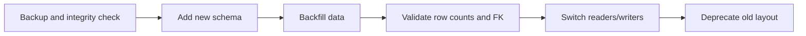

# SQLite migrations and PostgreSQL portability

> **Track:** `systems-engineering` · **Lesson:** 3 · **Target:** independent reasoning (4/5)  
> **Prerequisite:** read the track index and complete prior diagnostic questions.  
> **Outcome:** Apply schema changes safely while preserving existing metadata.

## Socratic opening — answer before reading

1. Why not edit the original `0001.sql` migration?
2. What if migration partially fails?
3. Why isn't a successful SQLite test sufficient to approve a PostgreSQL migration?

**Tutor protocol:** ask one question at a time in a live session. The tutor should not reveal the worked solution until the learner has attempted the problem and been probed on the reasoning. These questions are a study bank, not evidence of mastery.

## Core reasoning

Versioned schema migrations change table shape and indexes in defined order. Do not silently delete user data when a column changes. SQLite and PostgreSQL differ in types, concurrency and DDL behavior; repository boundaries reduce coupling but do not make SQL dialects automatically portable. Use migration tests on copies of real previous schema versions.

## Mathematical or engineering model

A migration invariant: after applying migration $m$, all previously accepted `instrument_id` values and foreign-key relationships remain valid unless an explicit, tested transformation is required. Define schema version with unique number, checksum and migration log; fail if already-applied migration bytes have changed.

## Worked example (read after attempting)

An original table stores `lot_size` in `instruments`. New design stores effective-dated rows in `contract_specifications`. Expand by adding table, backfill carefully, switch readers, then contract/remove old field only when validated; do not drop first.

## Visual model

## Failure modes and misconceptions

Identify the assumptions and find a counterexample before adopting the model. In MOSAIC, keep raw observations distinct from modelling assumptions.

## Build or paper exercise

Draft migration versions 0001–0003 and a backup/restore test plan. Include tests for partial failures and rerun behavior.

## Verification and cross-connections

Verify dimensional units, edge cases, reproducibility and whether each input was actually observable at decision time.

## Evidence and references

[SQLite transactions](https://www.sqlite.org/lang_transaction.html)

## Mastery gate

To claim **4/5**, solve two independent variants, including one without hints after a delay. To claim **5/5**, explain a counterexample, show an edge case and teach the model clearly. Record evidence in `docs/learning-material/MASTERY-TRACKER.md`.
