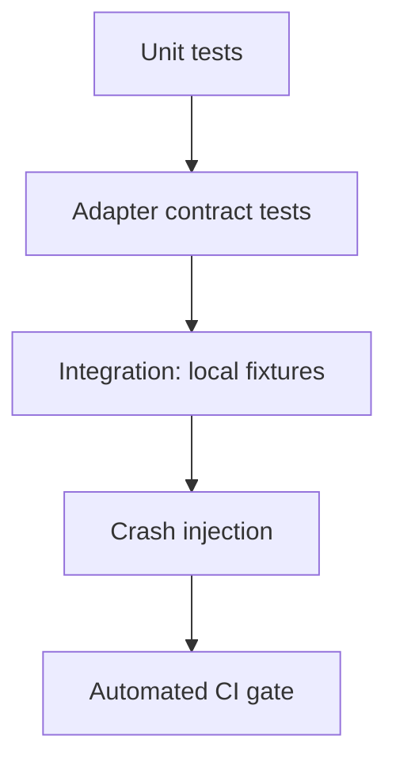

# Unit, contract, integration and recovery tests

> **Track:** `systems-engineering` · **Lesson:** 4 · **Target:** independent reasoning (4/5)  
> **Prerequisite:** read the track index and complete prior diagnostic questions.  
> **Outcome:** Design tests that prove data accuracy and failure recovery independently of external market availability.

## Socratic opening — answer before reading

1. How can a suite report 100% line coverage but miss data corruption?
2. What test catches a source parser silently swapping strike and lot size?
3. What exact state must remain invisible before manifest commit?

**Tutor protocol:** ask one question at a time in a live session. The tutor should not reveal the worked solution until the learner has attempted the problem and been probed on the reasoning. These questions are a study bank, not evidence of mastery.

## Core reasoning

Unit tests cover domain invariants, contract tests ensure implementations satisfy shared interfaces, integration tests wire multiple real components, and recovery tests inject failure boundaries. Network-dependent tests cannot be the only evidence. Include malformed files, empty files, duplicate rows, out-of-order observations and corrections. Distinguish `skipped live integration` from a passing live provider test.

## Mathematical or engineering model

An idempotency property: running the same validated import twice must not create a second logical dataset publication, under a defined equivalence policy. A metamorphic test might shuffle independent source rows and verify canonical normalized content is identical after deterministic sorting, if row ordering is not semantically meaningful for that data family.

## Worked example (read after attempting)

Test a crash after filesystem publish but before manifest commit, then restart. The query engine must expose either the prior committed state or the safely reconciled new state, never corrupt partial output.

## Visual model

## Failure modes and misconceptions

Identify the assumptions and find a counterexample before adopting the model. In MOSAIC, keep raw observations distinct from modelling assumptions.

## Build or paper exercise

Write five explicit Given/When/Then scenarios for registry, parser, durable publication, correction and stale source version handling.

## Verification and cross-connections

Verify dimensional units, edge cases, reproducibility and whether each input was actually observable at decision time.

## Evidence and references

[pytest good practices](https://docs.pytest.org/en/stable/explanation/goodpractices.html)

## Mastery gate

To claim **4/5**, solve two independent variants, including one without hints after a delay. To claim **5/5**, explain a counterexample, show an edge case and teach the model clearly. Record evidence in `docs/learning-material/MASTERY-TRACKER.md`.
