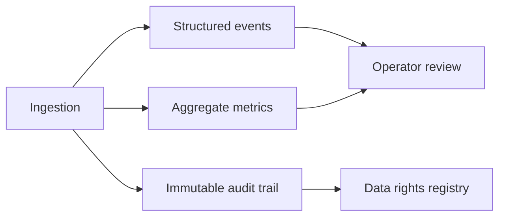

# Logs, metrics, audit and source rights

> **Track:** `systems-engineering` · **Lesson:** 5 · **Target:** independent reasoning (4/5)  
> **Prerequisite:** read the track index and complete prior diagnostic questions.  
> **Outcome:** Design an observable data pipeline that does not leak secrets or misrepresent provider entitlements.

## Socratic opening — answer before reading

1. How does a metric differ from a log?
2. Why could recording every instrument ID as a metric label be expensive?
3. Can publicly viewable data be redistributed without permission?

**Tutor protocol:** ask one question at a time in a live session. The tutor should not reveal the worked solution until the learner has attempted the problem and been probed on the reasoning. These questions are a study bank, not evidence of mastery.

## Core reasoning

Logs explain individual events, metrics aggregate system health, traces reconstruct cross-step timing. Audit entries capture externally meaningful state changes with actor, timestamp and provenance. Data source access and retention rights are distinct from technical ability to download. Never assume publicly visible exchange content permits unattended scraping or redistribution.

## Mathematical or engineering model

Example metrics: `ingestion_attempts_total`, `ingestion_failures_total{reason}`, `source_latency_seconds`, `uncommitted_artifacts`, `coverage_ratio{source,data_family}`. Keep labels low-cardinality; high-cardinality instrument IDs as time-series metric labels can overwhelm local monitoring.

## Worked example (read after attempting)

An ingestion job writes a structured record with job ID, parser version, raw hash, target manifest and outcome. It does not log API keys or dump private provider credentials. Audit who approved a paid source and whether data redistribution is permitted.

## Visual model

## Failure modes and misconceptions

Identify the assumptions and find a counterexample before adopting the model. In MOSAIC, keep raw observations distinct from modelling assumptions.

## Build or paper exercise

Design a job-status JSON schema for internal logs and a separate provider access checklist. List fields that must be redacted.

## Verification and cross-connections

Verify dimensional units, edge cases, reproducibility and whether each input was actually observable at decision time.

## Evidence and references

[NSE reports](https://www.nseindia.com/all-reports-derivatives) · [SEBI equity derivatives sources](https://www.sebi.gov.in/curation/equity_derivatives.html)

## Mastery gate

To claim **4/5**, solve two independent variants, including one without hints after a delay. To claim **5/5**, explain a counterexample, show an edge case and teach the model clearly. Record evidence in `docs/learning-material/MASTERY-TRACKER.md`.
