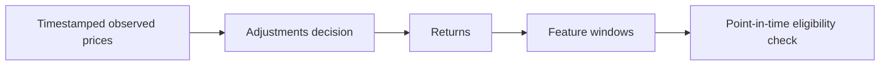

# Returns, log returns and resampling

> **Track:** `time-series` · **Lesson:** 1 · **Target:** independent reasoning (4/5)  
> **Prerequisite:** read the track index and complete prior diagnostic questions.  
> **Outcome:** Compute consistent returns and avoid double-counting or misaligned time indexes.

## Socratic opening — answer before reading

1. Why do +10% and −10% not cancel?
2. Can you sum daily arithmetic returns to obtain exact total return?
3. How does a partially finalized candle distort a historical resampling?

**Tutor protocol:** ask one question at a time in a live session. The tutor should not reveal the worked solution until the learner has attempted the problem and been probed on the reasoning. These questions are a study bank, not evidence of mastery.

## Core reasoning

Prices are not returns. Simple returns compound multiplicatively, while log returns add over contiguous periods. Total-return series require dividends and corporate actions. Resampling tick and bar data must specify interval closure, label time, timezone and what counts as a final bar.

## Mathematical or engineering model

Simple return $r_t=P_t/P_{t-1}-1$. Log return $g_t=\ln(P_t/P_{t-1})=\ln(1+r_t)$. Cumulative simple growth $\prod_t (1+r_t)-1$, while cumulative log growth $\sum_t g_t$. Arithmetic mean and geometric growth have different interpretations.

## Worked example (read after attempting)

A price goes 100→110→99. Returns are +10% and −10%; net return is −1%, not zero. Log returns are $\ln(1.1)$ and $\ln(0.9)$, summing to $\ln(0.99)$.

## Visual model

## Failure modes and misconceptions

Identify the assumptions and find a counterexample before adopting the model. In MOSAIC, keep raw observations distinct from modelling assumptions.

## Build or paper exercise

Build a five-row price table; calculate simple/log returns manually then cross-check in Python. Add one split and decide which price series is appropriate for each task.

## Verification and cross-connections

Verify dimensional units, edge cases, reproducibility and whether each input was actually observable at decision time.

## Evidence and references

[MOSAIC architecture: data and feature layers](../../architecture/05-feature-market-intelligence.md)

## Mastery gate

To claim **4/5**, solve two independent variants, including one without hints after a delay. To claim **5/5**, explain a counterexample, show an edge case and teach the model clearly. Record evidence in `docs/learning-material/MASTERY-TRACKER.md`.
