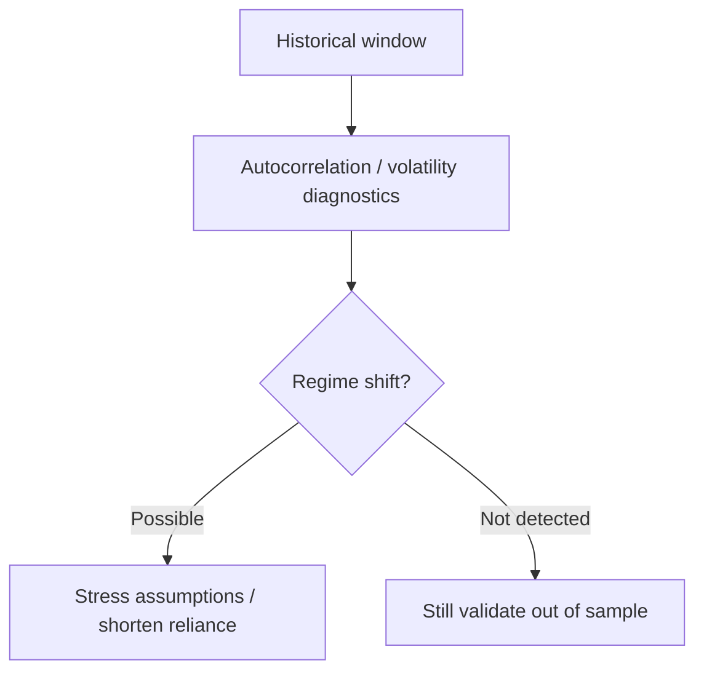

# Autocorrelation, non-stationarity and regime changes

> **Track:** `time-series` · **Lesson:** 2 · **Target:** independent reasoning (4/5)  
> **Prerequisite:** read the track index and complete prior diagnostic questions.  
> **Outcome:** Explain serial dependence and why backtest statistics fail under regime shifts.

## Socratic opening — answer before reading

1. Can zero return autocorrelation coexist with volatility predictability?
2. What does overlap in rolling windows do to sample independence?
3. Why is a regime label constructed using future returns dangerous?

**Tutor protocol:** ask one question at a time in a live session. The tutor should not reveal the worked solution until the learner has attempted the problem and been probed on the reasoning. These questions are a study bank, not evidence of mastery.

## Core reasoning

Market time series are often heteroskedastic and non-stationary. Volatility clustering can create serial dependence even when raw signed returns appear weakly autocorrelated. A strategy trained during one liquidity regime can fail under another. Stationarity is an assumption to assess, not a guarantee supplied by taking logarithms.

## Mathematical or engineering model

Lag-$k$ autocorrelation $\rho_k=Cov(r_t,r_{t-k})/Var(r_t)$ under suitable weak stationarity. A volatility proxy is rolling variance $s^2_t=(n-1)^{-1}\sum_{i=0}^{n-1}(r_{t-i}-\bar r_t)^2$. Rolling statistics are estimates with overlapping windows.

## Worked example (read after attempting)

Synthetic returns may be uncorrelated in sign while absolute returns cluster: several high-volatility days tend to occur together. A model that assumes stable $\sigma$ underestimates uncertainty during clusters.

## Visual model

## Failure modes and misconceptions

Identify the assumptions and find a counterexample before adopting the model. In MOSAIC, keep raw observations distinct from modelling assumptions.

## Build or paper exercise

Generate synthetic return series with two variance regimes. Plot rolling volatility and compare model risk estimates fit to the first versus second regime.

## Verification and cross-connections

Verify dimensional units, edge cases, reproducibility and whether each input was actually observable at decision time.

## Evidence and references

[MOSAIC architecture: feature market intelligence](../../architecture/05-feature-market-intelligence.md)

## Mastery gate

To claim **4/5**, solve two independent variants, including one without hints after a delay. To claim **5/5**, explain a counterexample, show an edge case and teach the model clearly. Record evidence in `docs/learning-material/MASTERY-TRACKER.md`.
