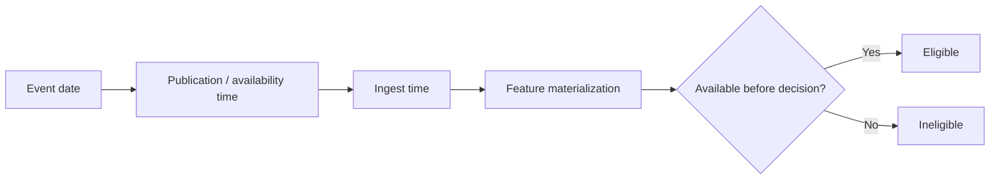

# Point-in-time features, labeling and leakage

> **Track:** `time-series` · **Lesson:** 3 · **Target:** independent reasoning (4/5)  
> **Prerequisite:** read the track index and complete prior diagnostic questions.  
> **Outcome:** Prevent future information from contaminating historical signals.

## Socratic opening — answer before reading

1. Why is `event_date <= decision_date` insufficient?
2. What happens when a vendor backfills a corrected historical value?
3. Can a label use the future while features cannot?

**Tutor protocol:** ask one question at a time in a live session. The tutor should not reveal the worked solution until the learner has attempted the problem and been probed on the reasoning. These questions are a study bank, not evidence of mastery.

## Core reasoning

Record the market event time, data publication time where known, ingestion time, and the time a feature became eligible for consumption. A financial statement labelled for a fiscal quarter may become public later; using it from the quarter-end date is lookahead. Labels deliberately use future outcomes for supervised training, but label data must not enter feature computation or evaluation selection improperly.

## Mathematical or engineering model

For decision at time $t$, require $available\_at(x)\le t$ for every input $x$ used to compute the feature. A sample label might be $y_t=\mathbf{1}[P_{t+h}/P_t-1>c]$, which by definition is not known at $t$. Purge or embargo overlapping training/test label horizons where appropriate.

## Worked example (read after attempting)

Suppose an earnings report covers the quarter ending March 31 but is published May 10. A model making an April 15 decision cannot use the subsequently published report, even if a database joins it on March 31.

## Visual model

## Failure modes and misconceptions

Identify the assumptions and find a counterexample before adopting the model. In MOSAIC, keep raw observations distinct from modelling assumptions.

## Build or paper exercise

Sketch a point-in-time join between two tables. Mark available_at separately from effective_date, and identify one row that must be excluded.

## Verification and cross-connections

Verify dimensional units, edge cases, reproducibility and whether each input was actually observable at decision time.

## Evidence and references

[MOSAIC architecture: storage lineage](../../architecture/03-storage-lineage-datasets.md)

## Mastery gate

To claim **4/5**, solve two independent variants, including one without hints after a delay. To claim **5/5**, explain a counterexample, show an edge case and teach the model clearly. Record evidence in `docs/learning-material/MASTERY-TRACKER.md`.
