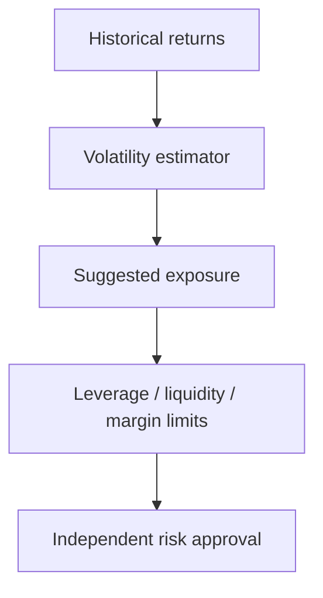

# Realized volatility, annualization and volatility targeting

> **Track:** `time-series` · **Lesson:** 4 · **Target:** independent reasoning (4/5)  
> **Prerequisite:** read the track index and complete prior diagnostic questions.  
> **Outcome:** Distinguish ex-post variation from an actionable ex-ante risk estimate.

## Socratic opening — answer before reading

1. Is annualized volatility independent of sampling calendar?
2. Why might a low estimated volatility increase future risk?
3. Does a risk limit disappear when the estimator says low risk?

**Tutor protocol:** ask one question at a time in a live session. The tutor should not reveal the worked solution until the learner has attempted the problem and been probed on the reasoning. These questions are a study bank, not evidence of mastery.

## Core reasoning

Historical realized volatility is computed from observed returns and is not a guaranteed forecast. Sampling frequency, session gaps, annualization assumptions and stale prices matter. A volatility-targeting rule can lever up in quiet periods just before volatility increases; include leverage caps and uncertainty controls.

## Mathematical or engineering model

For daily log returns $g_t$, sample daily volatility $s_g$, an approximate annualized estimate is $\hat\sigma_{ann}=s_g\sqrt{N}$ where $N$ is the assumed trading days/year (often approximately 252 for certain equity calendars, but verify the actual convention). A naive target weight $w=\sigma_{target}/\hat\sigma$ requires caps.

## Worked example (read after attempting)

If measured annualized volatility is 20% and target is 10%, a naive target weight is 0.5. If estimate drops to 5%, the rule suggests 2× gross exposure; a prudent system would apply leverage, margin and drawdown limits.

## Visual model

## Failure modes and misconceptions

Identify the assumptions and find a counterexample before adopting the model. In MOSAIC, keep raw observations distinct from modelling assumptions.

## Build or paper exercise

Plot rolling annualized volatility for a synthetic regime-switching return series and overlay capped versus uncapped target exposure.

## Verification and cross-connections

Verify dimensional units, edge cases, reproducibility and whether each input was actually observable at decision time.

## Evidence and references

[MOSAIC architecture: independent risk](../../architecture/10-independent-risk-authority.md)

## Mastery gate

To claim **4/5**, solve two independent variants, including one without hints after a delay. To claim **5/5**, explain a counterexample, show an edge case and teach the model clearly. Record evidence in `docs/learning-material/MASTERY-TRACKER.md`.
