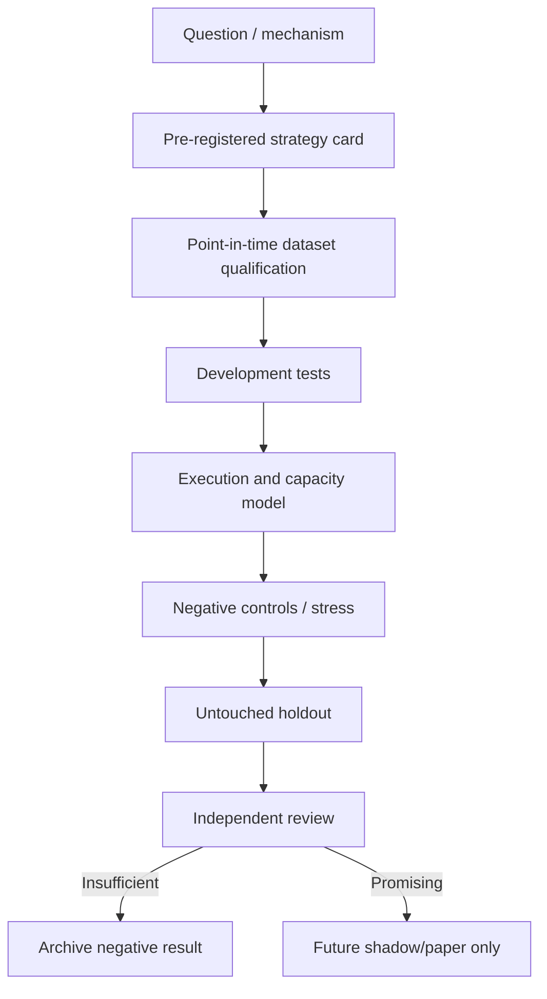

# Strategy Research Laboratory

This folder contains *research methods*, not deployed profitable strategies. All strategy examples are hypotheses requiring falsification. A feature or signal cannot grant itself capital or bypass risk.

## Recommended artifacts

- `strategy-card-template.md`: hypothesis, inputs, horizon, executable rules, benchmark, expected costs.
- `experiment-register.md`: log wins **and failures**, parameters and data release.
- `validation-checklist.md`: lookahead, survivorship, corporate actions, capacity, slippage, multiple testing.
- `strategy-taxonomy.md`: compare mechanisms and data needs.

## Research lifecycle

**Hard gate:** the V1 data platform makes data available; it does not certify a strategy as tradeable.
