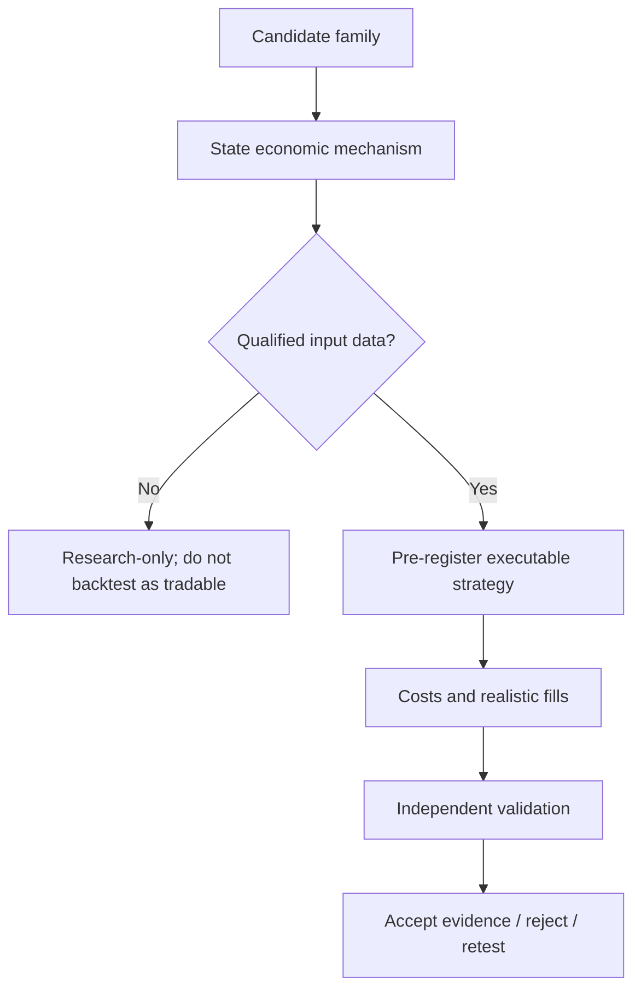

# Strategy taxonomy — mechanisms, data and failure conditions

A strategy family labels a hypothesis type, **not** an approved or profitable strategy. Use this matrix to choose what to investigate only after qualifying the appropriate data and rights.

| Family | Proposed economic mechanism | Minimum realistic inputs | Key failure condition | Indian-market specifics to verify |
|---|---|---|---|---|
| Time-series momentum | Price trends persist over a horizon | Point-in-time prices, corporate actions, costs | Choppy mean-reverting regimes | Session gaps, futures rolls, liquidity |
| Cross-sectional momentum | Winners outperform losers conditionally | Historical full universe, delistings, adjusted prices | Crowding, reversals, lookahead in universe | NSE segment membership over time |
| Mean reversion | Temporary liquidity shocks reverse | Execution timestamps, tradeable bid/ask or cost proxy | Structural break, persistent trend | Illiquid option gaps, STT/taxes, execution |
| Carry / futures basis | Compensation for financing/inventory exposure | Spot, futures contract terms, funding/dividends | Basis widens, funding changes | Roll dates, contract multipliers, settlement |
| Volatility relative value | Realized vs priced volatility differs | Options chain, IV inputs, underlying data, hedge costs | Jumps, model error, hedging friction | Expiry style, quote availability, Greeks provenance |
| Statistical arbitrage | Relative relationships temporarily diverge | Point-in-time universe, synchronized observations | Relationship breaks / correlation shock | Corporate actions, matched timestamps |
| Market making | Earn spread for providing liquidity | Quotes/depth/trades, order state, fill model | Adverse selection, queue risk | Venue rules, data access, latency constraints |
| Event-driven | Slow/heterogeneous reaction to public information | Publication timestamps, price/quote history | Signal priced in before execution | Announcement-time availability, trading halts |
| ML prediction | Complex features contain out-of-sample information | Reliable features, labels, splits, execution model | Leakage, regime shift, overfitting | Sparse derivatives, provenance, licensing |

## Selection sequence

**First research recommendation:** start with descriptive EOD equity returns and a *null-hypothesis benchmark*, not immediate capital deployment. Next, design one simple momentum or mean-reversion experiment whose input availability, costs, point-in-time universe and falsification criteria can be defended.

**Core check:** If a strategy appears to produce arbitrage-like returns using prices that couldn't be filled at those times, reject the execution model before tuning the signal.
